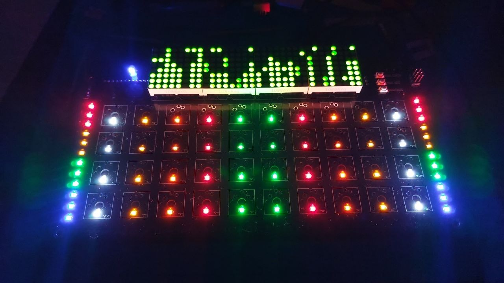
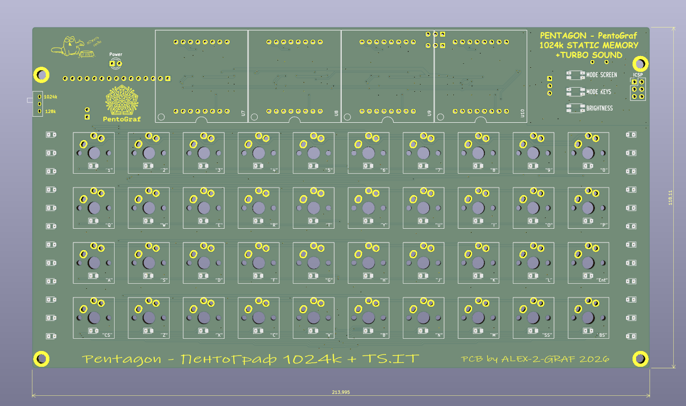
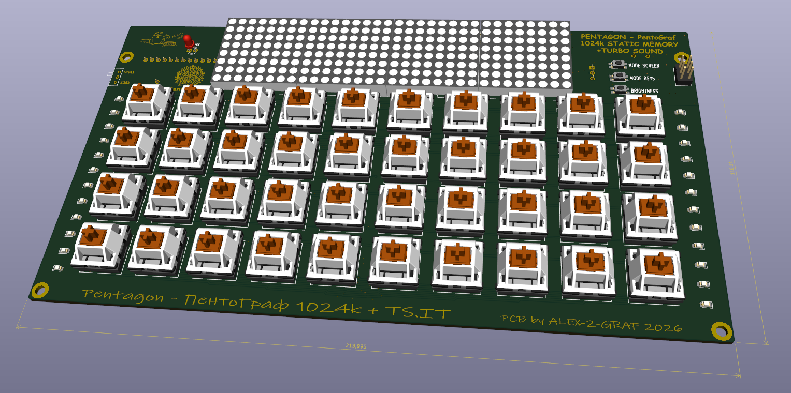

# ZX-Spectrum-Keyboard-Led
  
 Custom 40-key ZX Spectrum keyboard with built-in stereo FHT spectrum analyzer, dynamic key/underglow LED backlight, and DS1307 RTC clock (ATmega328P + MAX7219).  
   
---
  
Кастомная клавиатура (40 клавиш) для ZX Spectrum со встроенным стерео-спектроанализатором, динамической подсветкой клавиш, неоном и часами DS1307.  
  
---
  
> [English](README.en.md) | [Русский](README.md)
  
---
  
# 🎹 ZX-Spectrum-Keyboard-Led (PentoGraf)
**Кастомная клавиатура для ZX Spectrum со встроенным стерео-спектроанализатором, динамической подсветкой и часами.**

**PentoGraf** — это кастомный визуализатор звука, встроенный в компактную клавиатуру (40 клавиш) для компьютеров семейства ZX Spectrum (Pentagon и совместимых). Проект объединяет в себе двухканальный анализатор спектра, многорежимную динамическую подсветку клавиш с боковым неоном (Underglow) и точные часы реального времени.

  
  
---

## ✨ Основные возможности

* **Честный стерео-анализ (FHT):** Раздельная обработка левого и правого каналов звукового сопроцессора (AY-3-8910 / YM2149F) на базе быстрого преобразования Хартли (FHT, частота дискретизации АЦП — 38.4 кГц).
* **Интеллектуальный режим ожидания:** При отсутствии звука в течение 10 секунд верхний экран автоматически переключается в режим цифровых часов. При появлении сигнала — мгновенно возвращается к визуализации.
* **Автономные часы реального времени (RTC):** Базируются на микросхеме `DS1307Z` с резервным питанием от батарейки `CR2032` и удобной настройкой времени тремя штатными кнопками без подключения к ПК.
* **Независимое управление:** 10 режимов работы верхнего табло (32×8 пикселей) и 10 режимов подсветки клавиатуры + 5 уровней яркости.
  
---
  
## 🛠️ Аппаратная архитектура (Rev 1.02)  
  
  
  
  
  
  
* **Микроконтроллер:** `ATmega328P-AU` (TQFP-32, 16 МГц).
* **Индикация:** 5 каскадно включённых матриц на базе драйверов `MAX7219` (4 матрицы образуют верхнее табло 32×8, 5-я отвечает за подсветку клавиш и бокового неона).
* **Звуковой предусилитель:** Сдвоенный операционный усилитель `LM358` (коэффициент усиления ×10, виртуальная средняя точка 2.5 В, входы `PC0` и `PC1`). *Примечание: при желании можно установить pin-to-pin совместимый малошумящий Rail-to-Rail ОУ `MCP602` для максимальной линейности на высоких частотах.*
* **Часы реального времени:** `DS1307Z+` на аппаратной шине I2C (`PC4` / `SDA`, `PC5` / `SCL`) с часовым кварцем 32.768 кГц.
* **Питание (+5В):** Разделённые контуры питания для силовой светодиодной части (`MAX7219`) и цифровой/аналоговой части (`ATmega328P` + `LM358` + `DS1307` через LC-фильтр 33 мкГн), что полностью исключает наводки от динамической индикации в звуковой тракт.

---

## 🎛️ Управление и режимы работы

На плате предусмотрены 3 тактовые кнопки:
* **`SW42` (MODE SCREEN / SET)** — переключение режимов верхнего дисплея (`0–9`). Удержание 2 сек в режиме часов открывает настройку времени.
* **`SW43` (MODE KEYS / +)** — переключение режимов подсветки клавиатуры (`0–9`).
* **`SW44` (BRIGHTNESS / -)** — циклическое переключение 5 уровней яркости всей панели.

### 📟 Режимы верхнего экрана (`SW42`)
0. **Живой стерео-спектр с пиками** (левые 2 матрицы — левый канал, правые 2 — правый)
1. **Горизонтальный VU-метр**
2. **Вертикальный спектр от центра**
3. **Горизонтальный спектр от центра**
4. **Pac-Man** (ретро-анимация)
5. **Трансформирующаяся синусоида**
6. **Прыгающий дельфин**
7. **Звёздное небо**
8. **Плавающий логотип PentoGraf / Sinclair**
9. **Большие цифровые часы (`ЧЧ:ММ`)**

### ⌨️ Режимы подсветки клавиатуры (`SW43`)
0. **Эквалайзер от центра в стороны** (клавиши + неон)
1. **Эквалайзер снизу вверх**
2. **Плавный порядовый подъём**
3. **Матричный дождь**
4. **Мерцающее звёздное небо**
5. **Бегущая световая волна**
6. **Круговой радар**
7. **Полная статика** (клавиши + боковой неон)
8. **Статика без неона** (подсветка только 5 рядов клавиш для работы в темноте)
9. **Полное отключение** (аппаратный режим `Shutdown` драйвера клавиатуры)

### 🕒 Настройка часов
1. Переключите табло в **Режим 9 (Часы)**.
2. Зажмите **`SW42`** на 2 секунды — замигают **часы**. Настройте кнопками **`SW43` (+)** и **`SW44` (-)**.
3. Коротко нажмите **`SW42`** — замигают **минуты**. Настройте кнопками **`SW43` (+)** и **`SW44` (-)**.
4. Коротко нажмите **`SW42`** ещё раз для сохранения времени в память `DS1307`.

---

## 📦 Сборка

**Монтаж платы:**
   * При запайке часового кварца `32.768 кГц` внешние конденсаторы на землю **не устанавливаются** (встроены в `DS1307`). Корпус кварца рекомендуется припаять к полигону `GND` для экранирования.
   * На ножку `AREF` (пин 20 `ATmega328P`) устанавливается только блокировочный конденсатор `100 нФ` на землю (опорное напряжение `DEFAULT` = 5В).

---

## 📦 Прошивка микроконтроллера (HEX и фьюзы)

Для работы устройства используется готовый файл прошивки `ZX-Spectrum-Keyboard-Led.hex` из папки `/Firmware`. Прошивка осуществляется через стандартный разъём **ISP** любым программатором (USBasp, AVRISP mkII, TL866/XGecu и др.).

### ⚙️ Настройка Fuse-битов (`ATmega328P-AU`, внешний кварц 16 МГц)

Перед или сразу после записи `.hex` файла необходимо выставить следующие значения фьюзов:

* **Low Fuse (LFUSE):** `0xFF` *(внешний кварцевый резонатор 16 МГц, максимальный размах)*
* **High Fuse (HFUSE):** `0xDF` *(запуск программы напрямую с адреса `0x0000` без загрузчика; если шьётся файл с загрузчиком — `0xDE`)*
* **Extended Fuse (EFUSE):** `0xFD` *(контроль питания BOD 2.7 В; в некоторых программаторах, например XGecu/TL866, это же значение отображается как `0x05`)*
* **Lock Bits:** `0xFF` *(без блокировки чтения/записи)*

> ⚠️ **Важно:** Новый чип `ATmega328P` с завода настроен на внутренний генератор 1 МГц (`LFUSE = 0x62`). Без изменения фьюзов на внешний кварц 16 МГц анимация и обработка звука будут работать в 16 раз медленнее нормы!
  
---
  
## ⚖️ Лицензия / License  
  
Этот проект является открытым аппаратным обеспечением (Open Source Hardware). Графические материалы, схемы и топология печатной платы распространяются под лицензией **CERN OHL v2 Weak Reciprocal** (CERN-OHL-W-2.0).

Вы можете свободно распространять, модифицировать и производить это устройство при условии сохранения авторства **Alex-2-Graf** и публикации измененных исходных файлов платы под аналогичной открытой лицензией.

